# 마음잇다 (Maum:Link) 인수 보고서 v2

느린학습자를 위한 사회정서교육 앱 — 2026-10-13 업데이트판

| 항목 | 내용 |
| --- | --- |
| 서비스 주소 | https://maumlink.vercel.app |
| 대상 | 초등학교 2~3학년 느린학습자 (교사·보호자 동반 사용) |
| 사용 기기 | 스마트폰·태블릿·PC 브라우저. 홈 화면에 앱처럼 설치 가능. Android 앱(APK)으로도 빌드 가능 |
| 계정·개인정보 | 회원가입 없음, 이름·개인정보 수집 없음. 말로 이야기하기를 켠 경우에만 음성이 외부 서비스로 전송됨(§7) |
| 작성일 | 2026-10-13 |
| 이전 보고서 | 마음잇다 인수보고서 2026-10-07 (v1) |

---

## 1. v1 이후 달라진 점 한눈에

| 구분 | v1 (2026-10-07) | v2 (2026-10-13) |
| --- | --- | --- |
| 디자인 | 티일 색 카드형 화면 | 그림책 풍 카툰 디자인: 마을 지도, 탐험가 캐릭터 4명, 안내 강아지, 장소별 그림 |
| 이야기 수 | 4개 영역 4편 | **5개 영역 5편** (자기관리 「하고 싶은 말이 생겼을 때」 추가) |
| 학습 흐름 | 5단계 고정 | 설계서별 단계형 흐름: 감정·이유 고르기, 행동 선택, 친구와 대화, 순서 맞추기, 마음–몸 신호 연결, 말하기 연습 |
| 상황 그림 | 1장 | 1장 또는 여러 컷(자기관리는 2컷) |
| 입력 방법 | 보기 선택만 | 보기 선택 + **말로 이야기하기**(마이크로 말하면 AI가 짧게 대답하고 같은 목소리로 읽어 줌) |
| 마무리 | 고정 문장 | 고정 문장 + 말한 적이 있으면 **아이의 말을 인용한 개인 마무리** |
| 음성 | 128문장 녹음 | **236문장 전부** 아동 목소리(Lulu Lolipop)로 녹음 |
| 이어하기 | 자동 이어하기 | 목록에서 **이어서 할까요? / 다시 해볼까요?** 묻기 |
| 품질 확인 | 단위·브라우저 검사 | 단위 94개, 브라우저 9개 흐름(가짜 마이크 포함), GitHub Actions 자동 실행 |

---

## 2. 앱 소개

**마음잇다**는 느린학습자가 익숙한 학교 상황을 그림과 짧은 문장으로 보고, 자신의 감정과 이유를 알아차리고, 더 나은 방법을 스스로 골라 보는 사회정서교육(SEL) 앱입니다. v2는 "마음마을 탐험"이라는 하나의 이야기 틀 안에 다섯 영역을 배치해, 아이가 지도에서 장소를 고르듯 학습을 시작합니다.

**느린학습자를 위한 설계 원칙**

- 한 화면에 한 가지 일. 큰 글자, 큰 버튼, 그림 중심.
- 감정과 이유에는 정답이 없습니다. 어떤 선택도 "틀렸어요"라고 말하지 않고, 다시 생각해 볼 보기에는 설계서의 피드백을 보여 주고 다시 고르게 합니다.
- 모든 문장을 같은 아동 목소리로 읽어 줍니다. 화면이 바뀌면 자동으로, 보기를 누르면 그 보기를 읽습니다.
- 미션(친구와 대화하기 등)은 건너뛰어도 이야기를 마칠 수 있습니다.
- 중간에 나가도 진행이 저장되고, 돌아오면 이어서 할지 묻습니다.

---

## 3. 모든 기기에서 같은 앱

<strong>탐험 지도 — 스마트폰 · 태블릿 · PC</strong>

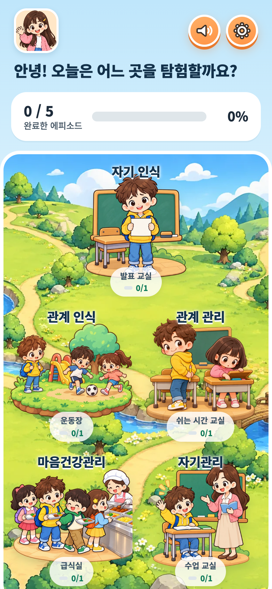
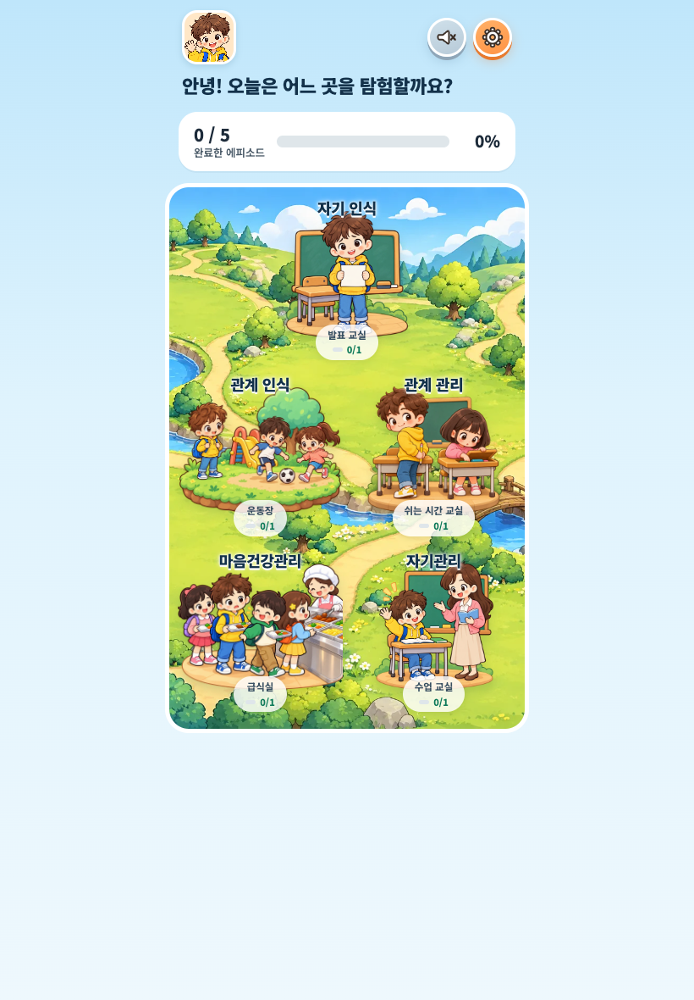
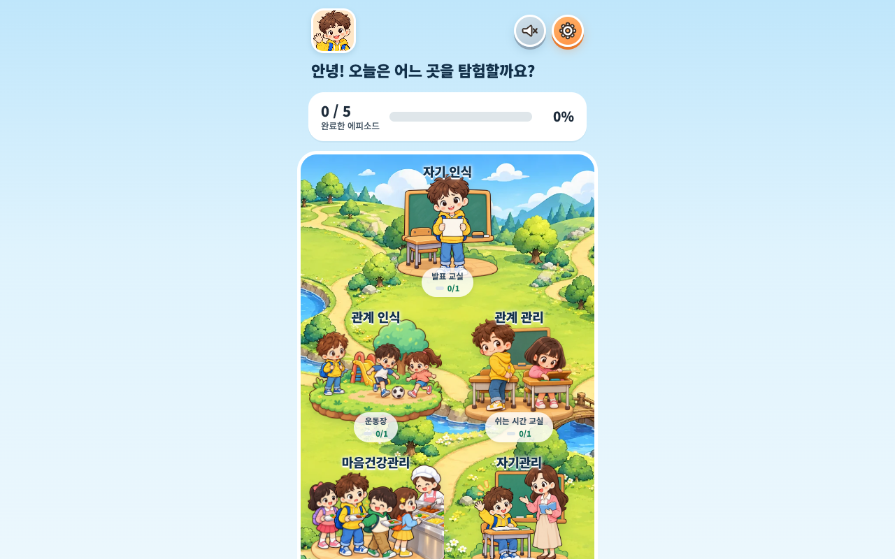

화면 폭에 맞춰 지도 위 장소 배치만 달라지고, 버튼과 글자 크기는 유지됩니다. 설정에서 글자를 더 키울 수 있습니다.

---

## 4. 화면 흐름 (스마트폰 화면)

### 4-1. 시작 · 탐험가 고르기 · 탐험 지도

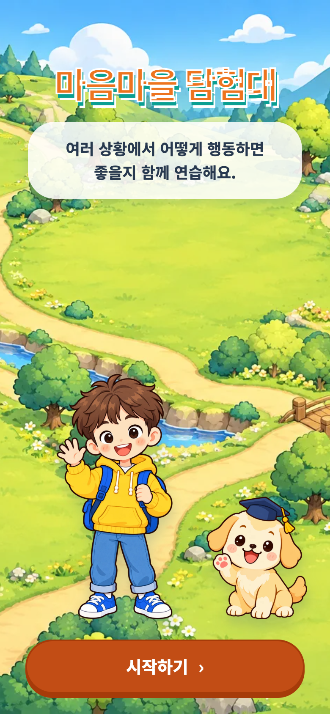
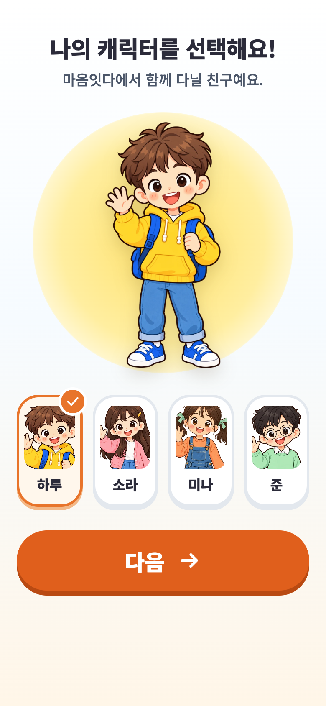

첫 화면은 마음마을 배경 위에서 안내 강아지와 주인공이 움직이는 **시작하기** 화면입니다. 한 번 누르면 음성 재생이 준비됩니다. 이어서 하루·소라·미나·준 네 탐험가 중 하나를 고릅니다(홈의 캐릭터를 누르면 언제든 바꿀 수 있음). 탐험 지도에는 다섯 영역이 장소 그림으로 놓여 있고, 장소마다 완료 수(0/1)가 보입니다. 위쪽에는 완료한 에피소드 수와 비율, 오른쪽 위에는 음성 켜기/끄기와 어른 설정 버튼이 있습니다.

### 4-2. 이야기 목록 · 이어서 할까요?

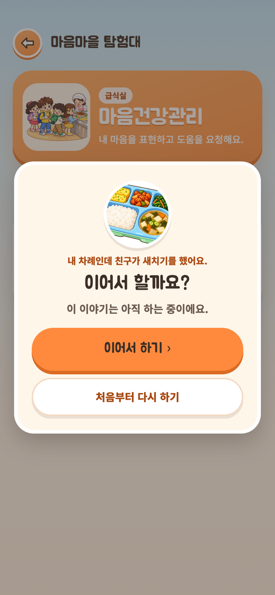

장소를 누르면 그 영역의 이야기 목록이 나옵니다. 하던 중인 이야기를 누르면 **이어서 할까요?**(이어서 하기 / 처음부터 다시 하기), 완료한 이야기를 누르면 **다시 해볼까요?**(처음부터 다시 하기 / 아니요)를 먼저 물어 실수로 진행을 잃지 않게 합니다. 처음 하는 이야기는 바로 열립니다.

### 4-3. 상황 보기

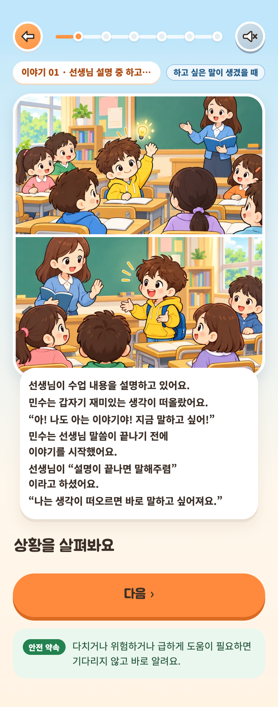

설계서의 상황 이야기를 그림과 함께 한 문장씩 보여 줍니다. 자기관리 영역은 설계서 요청대로 "말하고 싶은 마음이 드는 장면"과 "실제로 말을 시작하는 장면"을 두 컷으로 나눠 그렸습니다. 모든 그림은 같은 그림책 풍으로 생성했고, 주인공을 비난하는 표정은 쓰지 않았습니다. 아래의 **안전 약속**은 모든 화면에 고정되어, 어렵거나 위험하면 어른에게 알려도 된다는 점을 늘 보여 줍니다.

### 4-4. 감정 알아보기 · 말로 이야기하기

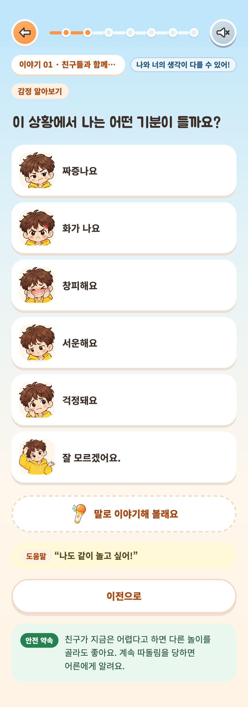
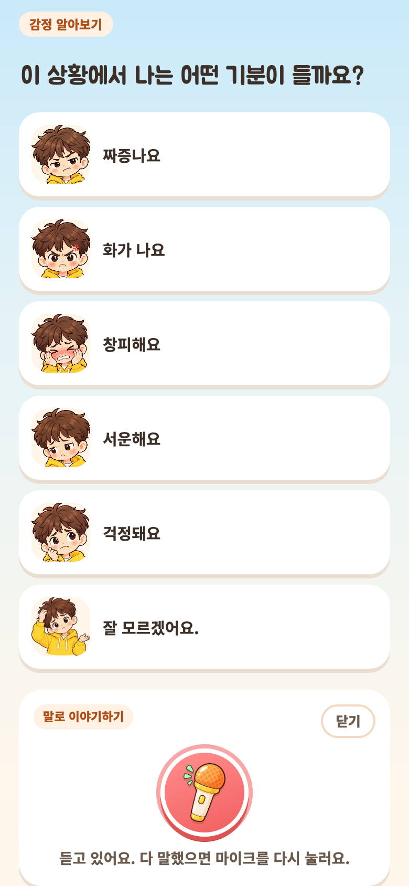
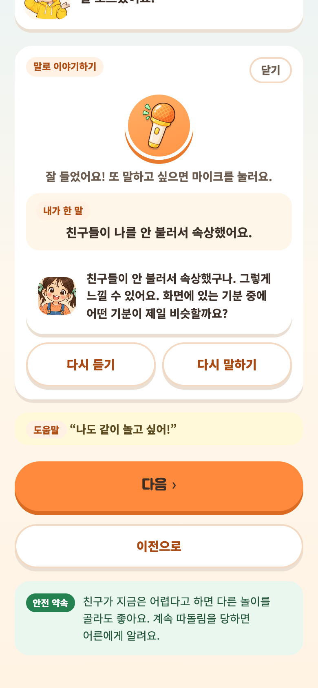

감정 단어와 주인공의 표정 카드를 함께 보여 줍니다. 보기를 누르면 그 보기를 읽어 주고 **다음**이 열립니다. "잘 모르겠어요"도 보기에 있습니다.

보기 아래의 **말로 이야기해 볼래요**를 누르면 마이크 패널이 열립니다(v2 신규). 마이크를 한 번 누르면 녹음, 다시 누르면 보냅니다. 잠시 뒤 **내가 한 말**(아이가 말한 그대로)과 탐험가 친구의 짧은 대답이 나타나고, 대답은 녹음 음성과 같은 아동 목소리로 읽어 줍니다. 말한 내용은 그 화면의 답으로 인정되어 **다음**이 열리지만, 자동으로 넘어가지 않고 아이가 직접 누릅니다. 보기를 함께 골라도 됩니다. 마이크를 못 쓰거나 인터넷이 없으면 아이 말로 안내하고, 보기 고르기는 그대로 할 수 있습니다.

### 4-5. 행동 선택과 피드백

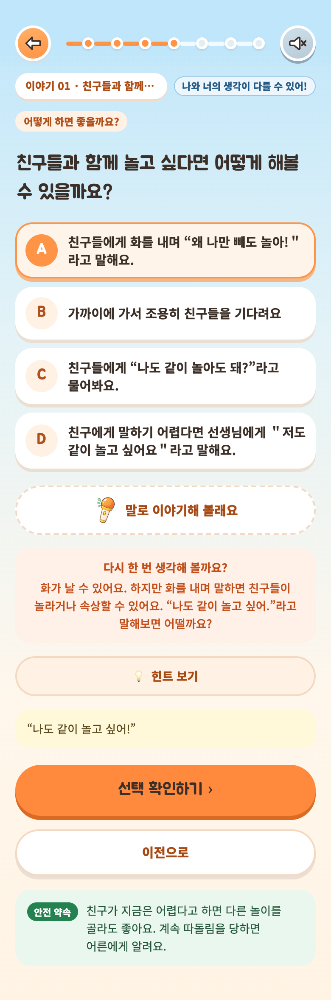

A~D 중 하나를 고르고 **선택 확인하기**를 누릅니다. 설계서가 권장하는 보기는 여러 개일 수 있고, 다시 생각해 보게 하는 보기(예: 화를 내며 말하기)는 "다시 한 번 생각해 볼까요?"와 설계서의 피드백 문장을 보여 준 뒤 다시 고르게 합니다. **힌트 보기**는 설계서의 핵심 문장을 보여 줍니다. 확인한 뒤에도 다른 보기를 누르면 바꿀 수 있습니다.

### 4-6. 친구와 대화하기 (관계 인식)

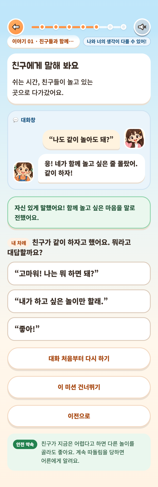

대화창에서 할 말을 고르면 친구가 잠시 "입력 중"을 보인 뒤 대답합니다. 잘 전해진 말에는 "자신 있게 말했어요!"와 설계 의도 문장이 붙고, 그렇지 않은 말은 바로 다시 고를 수 있습니다. 대화는 처음부터 다시 할 수 있고, 어려우면 **이 미션 건너뛰기**로 넘어가도 이야기를 마칠 수 있습니다.

### 4-7. 말하기 연습 (마음건강관리)

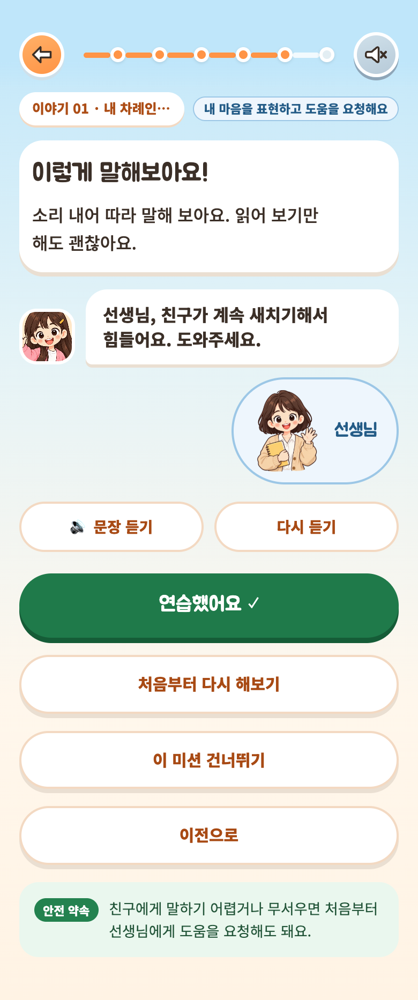

도움을 요청하는 문장을 **문장 듣기**로 들은 뒤 소리 내어 따라 말해 봅니다. 읽어 보기만 해도 괜찮다고 안내하며, **연습했어요**를 누르면 마무리로 갑니다.

### 4-8. 마무리 — 고정 문장과 개인 마무리

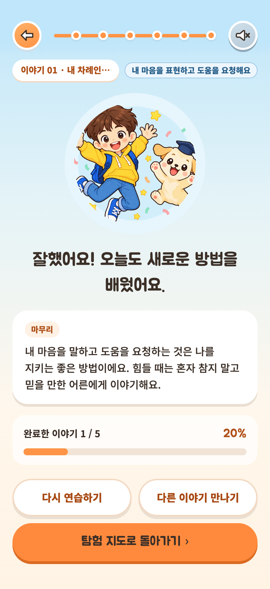
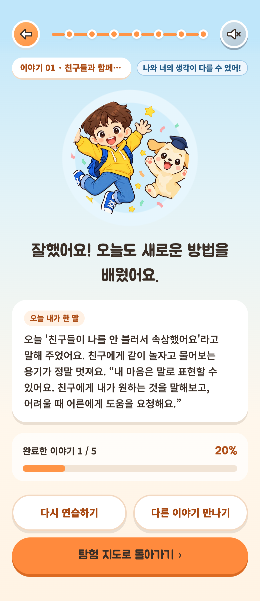

모든 이야기의 마무리는 "잘했어요! 오늘도 새로운 방법을 배웠어요." 다음에 설계서의 마무리 문장을 보여 줍니다(왼쪽). 이야기 중에 말로 이야기한 적이 있으면(오른쪽) **오늘 내가 한 말** 카드에 아이가 한 말을 인용하는 두 문장을 AI가 쓰고, 그 뒤에 설계서 마무리 문장을 **원문 그대로** 붙여 같은 목소리로 읽어 줍니다. 만든 문장은 그 이야기에 저장되어 다시 열어도 새로 만들지 않습니다. 아래에는 전체 완료 수와 비율, **다시 연습하기 / 다른 이야기 만나기 / 탐험 지도로 돌아가기**가 있습니다.

### 4-9. 어른 설정

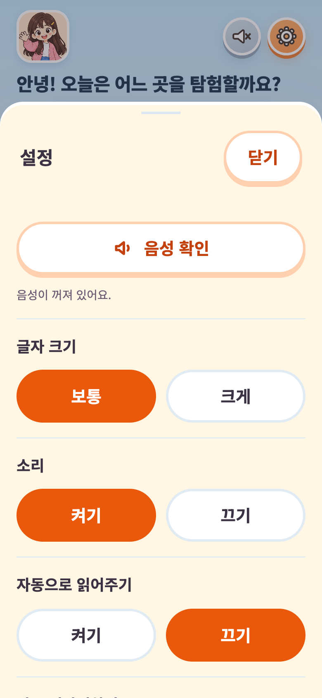
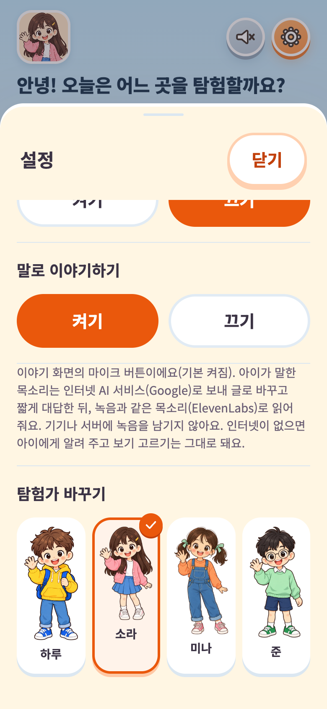

음성 확인, 글자 크기(보통/크게), 효과음, 자동으로 읽어주기, **말로 이야기하기**(기본 켜짐, 끌 수 있음), 탐험가 바꾸기를 조절합니다. 말로 이야기하기 아래에는 음성이 어디로 전송되는지 어른이 읽을 수 있는 설명이 있습니다.

---

## 5. 콘텐츠 구성 (5개 영역 5편)

| 영역 | 지도 장소 | 이야기 | 단계 구성 |
| --- | --- | --- | --- |
| 자기 인식 | 발표 교실 | 친구들이 내 발표 실수를 듣고 놀린다 | 감정 → 이유 → 마음–몸 신호 연결 → 방법 알아보기 |
| 관계 인식 | 운동장 | 친구들과 함께 놀고 싶어요 | 감정 → 이유 → 행동 선택 → 친구와 대화하기 → 행동 선택 |
| 관계 관리 | 쉬는 시간 교실 | 나는 장난이었는데, 친구는 속상해요 | 감정 → 이유 → 행동 선택 → 친구와 대화하기 → 순서 맞추기 → 마무리 메모 |
| 마음건강관리 | 급식실 | 내 차례인데 친구가 새치기를 했어요 | 감정 → 이유 → 방법 고르기 → 표현 고르기·말하기 연습 |
| 자기관리 | 수업 교실 | 선생님 설명 중 하고 싶은 말이 떠올랐어요 | 감정 → 이유 → 친구의 마음과 행동 알아보기 → 나도 해볼 수 있어요 |

- 모든 문장은 다섯 영역 콘텐츠 설계서(자기관리는 국지우 수정본) 원문을 그대로 썼습니다. 원문의 표기(예: 새채기)도 그대로 두었으니 고칠 문구가 있으면 알려 주시면 반영합니다.
- 단계 구성과 "잘 모르겠어요", 친구 대답, 안전 약속, 말로 이야기하기의 안내 문구와 AI 대답 규칙은 앱에서 더한 초안이며 교육자 검토를 기다립니다.

---

## 6. 음성

- **녹음 음성**: 화면이 읽는 236문장 전부를 ElevenLabs 아동 목소리(Lulu Lolipop, Eleven v4)로 녹음해 앱에 넣었습니다. 재생에 통신이나 추가 비용이 들지 않고, 오프라인에서도 들립니다.
- **말로 이야기하기의 대답**: 아이가 말한 소리는 Google Gemini 3.5 Transcribe가 글로 바꾸고, Gemini가 두 문장 이내로 대답하고, ElevenLabs가 같은 목소리로 읽습니다. 대답 규칙: 쉬운 말, 감정 수용, 평가·훈계 금지, 사람 이름 사용 금지, 위험 신호가 있으면 어른에게 알리라고 안내.
- 실제 키로 확인한 한 차례: 말한 문장이 정확히 글로 바뀌고(“친구들이 나를 안 불러서 속상했어요.”), 대답까지 약 8~9초가 걸렸습니다. 글로 바꾸는 데 4초가 가장 깁니다.

---

## 7. 개인정보와 외부 전송

| 상황 | 전송 여부 |
| --- | --- |
| 이야기 보기, 보기 고르기, 녹음 음성 듣기, 완료 기록 | 전송 없음. 설정·진행·완료는 기기 안에만 저장 |
| 말로 이야기하기(설정에서 켠 경우) | 말한 소리 → Google(글로 바꾸기, 대답), 대답 글 → ElevenLabs(읽기). 그 순간만 전송하며 서버·기기에 녹음과 대화를 남기지 않음 |

- API 키는 서버에만 있고 앱 파일에는 들어 있지 않습니다.
- 말로 이야기하기는 어른 설정에서 끌 수 있습니다. 끄면 마이크 버튼이 보이지 않습니다.

---

## 8. 설치와 운영

- **웹**: 주소로 접속한 뒤 iPad·iPhone은 Safari 공유 → "홈 화면에 추가", Android·PC Chrome은 메뉴 → "앱 설치". 한 번 접속하면 그림과 음성까지 저장되어 인터넷 없이도 실행됩니다(말로 이야기하기 제외).
- **Android 앱**: 같은 화면을 담은 APK를 빌드할 수 있습니다(마이크 권한 포함).
- **서버**: 정적 사이트 + 말로 이야기하기용 작은 서버 함수 하나(Vercel). 데이터베이스는 없습니다. 운영자는 Vercel 환경 변수에 Google AI 키와 ElevenLabs 키만 넣으면 됩니다.
- **콘텐츠 수정·추가**: 설계서 형식으로 전달해 주시면 문장·그림·음성을 함께 갱신해 같은 주소로 배포합니다. 새 문장의 음성은 명령 한 번으로 같은 목소리로 생성됩니다.

---

## 9. 품질 확인

| 항목 | 결과 |
| --- | --- |
| 콘텐츠 검증(설계서 원문 대조, 구조) | 5편 통과 |
| 단위 검사 | 94개 통과 (단계 엔진, 이어하기, 말로 이야기하기, 마무리, 음성) |
| 브라우저 검사 (Chrome, 실제 빌드) | 9개 흐름 통과: 5편 완주(3가지 화면 폭), 비권장 선택·힌트·이어하기, 저장 공간 부족, 목록 이어서/다시, 말로 이야기하기(가짜 마이크로 녹음→대답→마무리) |
| 접근성 | 각 화면 WCAG 2.1 AA 자동 검사 포함 |
| 자동 실행 | GitHub에 올릴 때마다 위 검사가 자동으로 실행됨 |
| 실제 기기 | Mac Chrome에서 음성·마이크 확인. 학교 iPad·Android 태블릿 확인은 인수 후 함께 진행 권장 |

**남은 과제**

- 교육자 검토: 앱이 더한 문구(단계 구성, 안내문, AI 대답 규칙).
- 말로 이야기하기 응답 시간 단축(실시간 글로 바꾸기 모델 적용 검토).
- 실제 교실 기기에서 마이크·오프라인·스크린리더 확인, 아동 관찰.

---

## 10. 전달 자료

- 서비스 주소: https://maumlink.vercel.app
- 소스 코드: https://github.com/prof-lijar/maumlink
